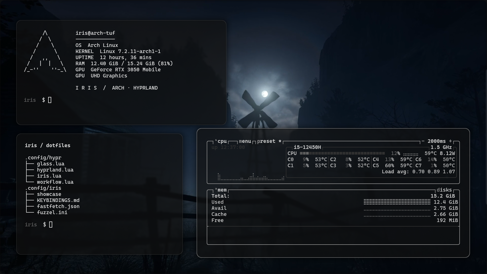
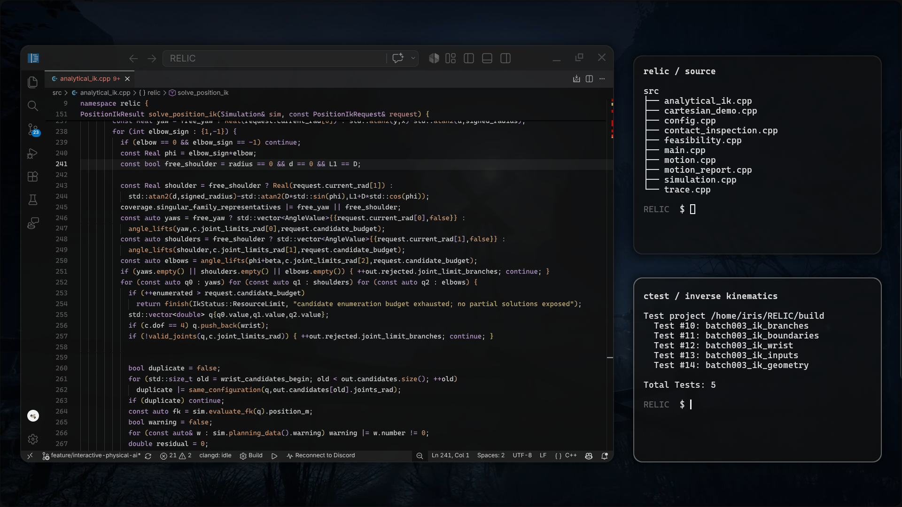
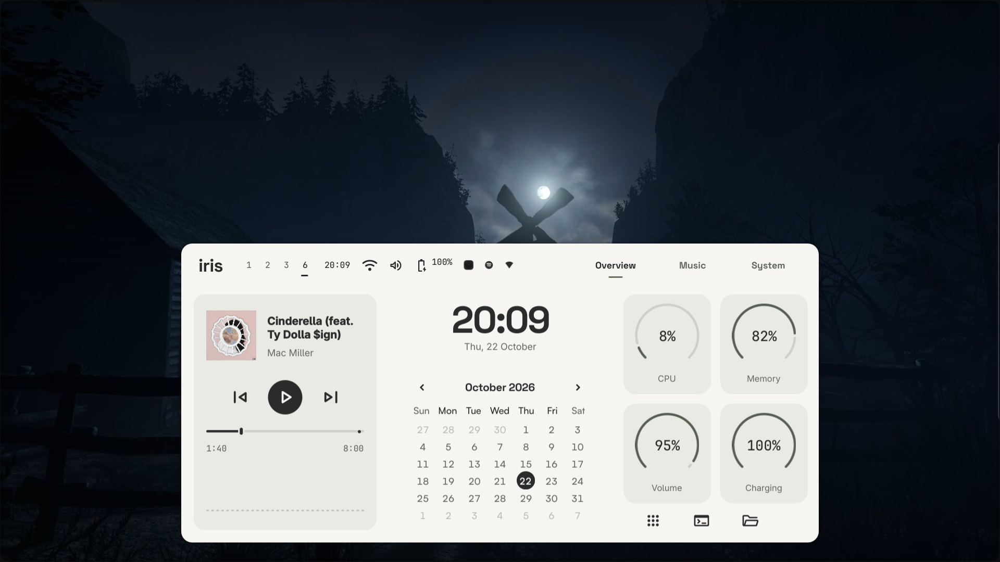
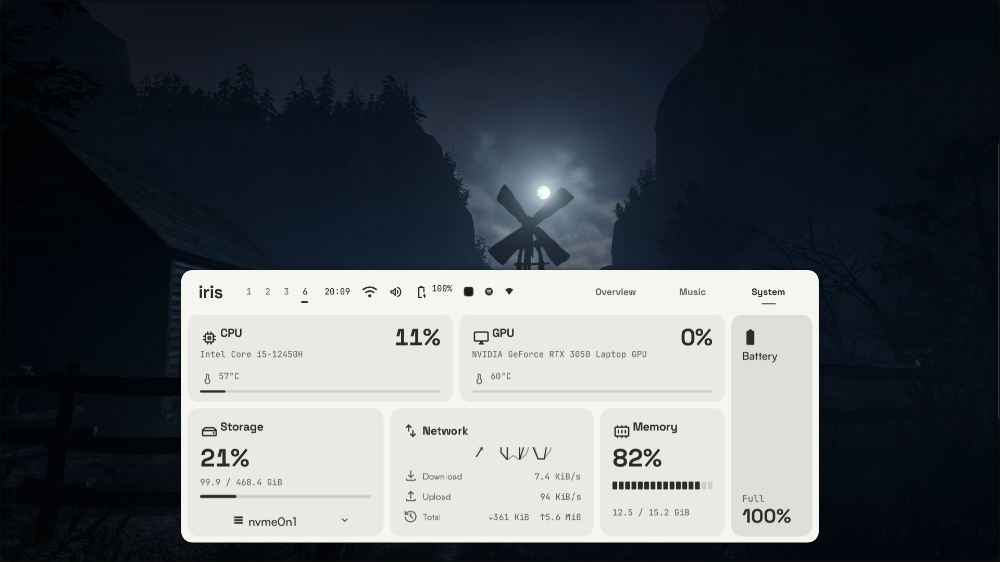

# iris

My Arch Linux desktop with Hyprland, a customized Caelestia shell, Kitty, and Zen. Monochrome glass, floating terminals, a compact application rail, and an eerie moon live wallpaper.

## terminals first

System identity. Dotfiles. Live vitals.

## work in progress

RELIC's inverse kinematics, in C++. Code on the left; source and test discovery on the right.

## one keystroke away

`Super+G` toggles the dashboard. `Super+Shift+G` opens Overview. Moon still in view.

System · Ctrl+Super+G

CPU, GPU, memory, and network. A quick check, then back to work.

